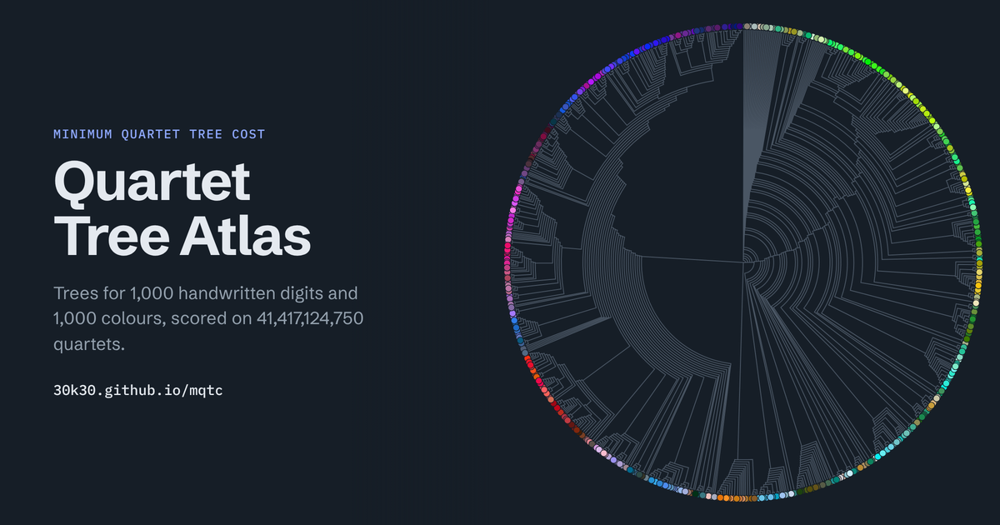

# Quartet Tree Atlas

[](https://30k30.github.io/mqtc/)

**[Open the Atlas](https://30k30.github.io/mqtc/)** · [demo video, 44 s](media/quartet-tree-atlas.mp4) · [lab notebook](LOG.md)

Any four objects can be split into two pairs in three ways. A tree picks one split for every
quartet, and the split ab|cd costs d(a,b) + d(c,d). The *minimum quartet tree cost* problem
(Cilibrasi & Vitányi) asks for the tree with the lowest total over all C(n,4) quartets. It is
NP-hard, and the published heuristics report trees of a few hundred objects. The Atlas shows trees for
1,000 handwritten digits and 1,000 colours, with 41,417,124,750 quartets each.

S(T) rescales the cost: 1 would put every quartet in its cheapest split, 0 every quartet in its dearest.

| data | n | S(T), this solver | S(T), neighbour joining | search (2 cores) |
|---|---|---|---|---|
| sklearn digits, Euclidean on pixels | 100 | 0.8523 | 0.8163 | 20 s |
| | 300 | 0.8550 | 0.8181 | 60 s |
| | 1000 | 0.8441 | 0.7861 | 187 s |
| random sRGB colours, CIEDE2000 | 100 | 0.9335 | 0.8557 | 20 s |
| | 300 | 0.9409 | 0.8612 | 60 s |
| | 1000 | 0.9469 | 0.6360 | 198 s |

At n = 1000 the search reaches its plateau in about a minute; the rest of the budget barely moves it.

## How it works
* **Moves priced in O(1).** The cost is linear in d with tree-dependent weights. Moving a subtree
  across one node changes only the quartets with one leaf in each of four block sums, so every
  subtree-prune-and-regraft (SPR) candidate is priced in O(1) and the whole SPR neighbourhood in
  O(n²). At n = 1797 one sweep prices 12.9 million candidate trees in under half a second. The
  earlier heuristics re-cost each candidate tree in O(n³).
* **Exact local rearrangements.** The subtrees around a connected core of 10 internal nodes are
  rearranged optimally by a subset DP: an exact 12-leaf instance on block sums.
* **Recombination.** A population of local optima, built in parallel from noisy quartet-join starts,
  random trees and large kicks, is fused by an exact DP over all their clusters (as in ASTRAL), then
  polished again.
* **Exact S at scale.** The O(n⁴) normaliser in vectorised C: 11 s at n = 1000 on 2 cores.

Derivations are in [notes/derivations.md](notes/derivations.md), what is new and what is not in
[notes/contributions.md](notes/contributions.md), and what failed in [notes/dead-ends.md](notes/dead-ends.md).

## What the trees can and cannot tell you
* **Read small clades, not the backbone.** Two n = 1000 digit searches whose S differ by 0.0000002 share
  93% of their two-leaf clades but only 2 of the 27 clades with more than 100 leaves.
* **The objective fits, it does not denoise.** On a tree metric with ±15% noise the MQTC tree is cheaper
  than the true tree, and slightly further from it than neighbour joining.
* **Digits are not tree-like.** S plateaus around 0.84–0.86 for digits, against 0.93–0.95 for colours. The tree is a summary of the distances, not a claim that they came from a tree.

## Run it
Node 18 or later; Python 3 with numpy and scikit-learn for the data; a C compiler with OpenMP.
```sh
(cd data && python3 make_data.py && python3 make_data.py all)   # matrices; checked against SHA256SUMS
gcc -O3 -march=native -fopenmp -o src/qbounds src/qbounds.c
src/qbounds data/digits_1000.txt > data/digits_1000.bounds.txt  # exact M, m for S(T)
node src/mqtc.js data/digits_1000.txt --seconds 60 --threads 8 \
     --bounds data/digits_1000.bounds.txt --json tree.json        # tree.json has the Newick string
node experiments/01_correctness.js                               # every fast formula against brute force
```
`mqtc.js` reads any square distance matrix (plain or PHYLIP, optional row labels). Options:
`--seconds`, `--threads` (default: all cores), `--pop`, `--k`, `--seed`.

Rebuilding the site:
```sh
sh experiments/07_demo_trees.sh            # searches, then demo/build.js -> demo/index.html
node demo/make_site.js --repo 30k30/mqtc   # -> index.html with vendored d3 and fonts
python3 -m http.server 8765 &              # make_card.py needs the page over http
python3 demo/make_card.py                  # -> media/card.png, the link-preview image
python3 demo/video/render_video.py --outro "30k30.github.io/mqtc"   # -> the demo video
```

## Layout
```
index.html          the Atlas, self-contained (assets/ holds d3 and the fonts)
media/              demo video and link-preview card
src/mqtc.js         solver: module and CLI, no dependencies
src/qbounds.c       exact normaliser for S(T)
src/previous/       the earlier subset-DP and DP-hill-climbing code, for comparison
data/               make_data.py, small matrices, exact bounds, metadata
experiments/        one script per experiment, numbered as in LOG.md
results/            their logs, tables and best trees (JSON with Newick)
notes/              derivations, contributions, dead ends, literature
LOG.md              the lab notebook
```
The n = 1000 and n = 1797 matrices (9–29 MB each) are not committed; `make_data.py` regenerates them
byte-identically.

## Credits
Problem and S(T): R. Cilibrasi and P. M. B. Vitányi, *A Fast Quartet Tree Heuristic for Hierarchical
Clustering*, Pattern Recognition 44 (2011). Digits: the UCI optical recognition of handwritten digits
data as shipped with scikit-learn. [d3](https://d3js.org) 7.9.0, ISC licence
([assets/LICENSE-d3.txt](assets/LICENSE-d3.txt)). Schibsted Grotesk and IBM Plex Mono, SIL Open Font
Licence ([assets/fonts](assets/fonts)).
